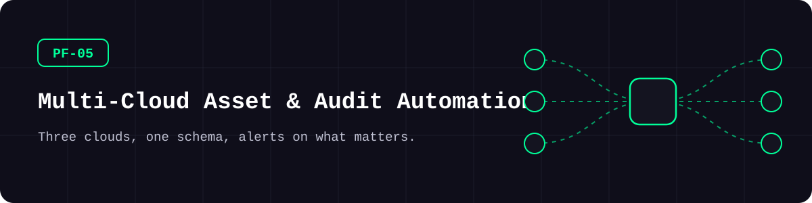
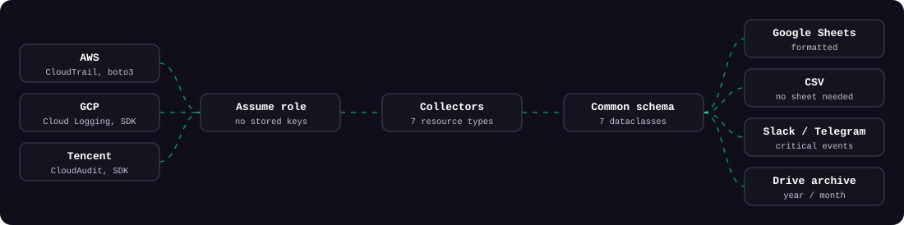
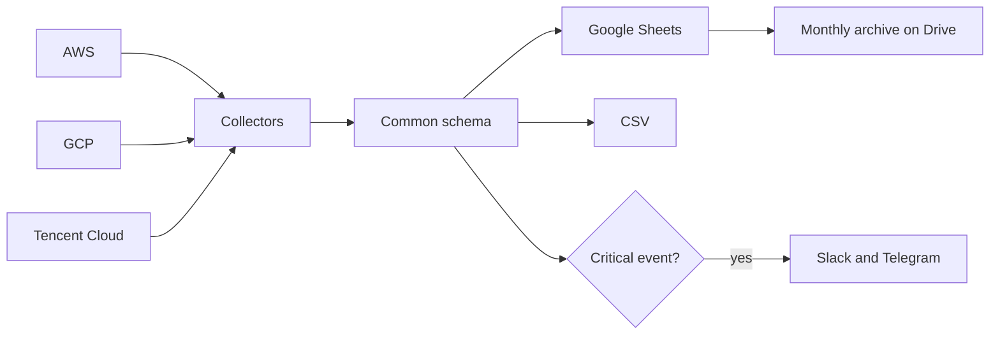

<picture>
  <source media="(prefers-color-scheme: dark)" srcset="docs/assets/banner-dark.svg">
  <source media="(prefers-color-scheme: light)" srcset="docs/assets/banner-light.svg">
  
</picture>

**3개 클라우드의 자산·권한·감사 로그를 표 하나로 모으고, 위험한 행위가 생기면 바로 알려 줍니다.**

[](https://github.com/kimjhtlzk/pf-05-multicloud-asset-audit-automation/actions/workflows/ci.yml)    [](https://github.com/kimjhtlzk/pf-05-multicloud-asset-audit-automation/actions/workflows/ci.yml) [](LICENSE)

[English](README.md) | 한국어 · [포트폴리오](https://github.com/kimjhtlzk)

## 한눈에 보기

- **클라우드 3개, 리소스 7종, 공통 스키마 1개**
- **감사 이벤트 49종 추적, 그중 16종은 즉시 알림**
- 폴더마다 반복되던 **스크립트 9,800줄을 약 2,150줄로** 줄였습니다
- **`--demo`로 바로 실행**할 수 있습니다 (가짜 데이터, 자격증명·네트워크 불필요)

## 구조

<picture>
  <source media="(prefers-color-scheme: dark)" srcset="docs/assets/pipeline-dark.svg">
  <source media="(prefers-color-scheme: light)" srcset="docs/assets/pipeline-light.svg">
  
</picture>



## 데모


## 구성 요소

| 기능 | 설명 | 주요 API |
|---|---|---|
| `iam` | 사용자, 그룹, 권한, 키, 마지막 로그인 | IAM, CAM, Resource Manager |
| `firewall` | 규칙·대상별 한 줄 | 보안 그룹, GCP 방화벽 |
| `instance` | 사양, 디스크, IP, 상태, 삭제 방지 | EC2, Compute, CVM |
| `loadbalancer` | 리스너, 대상, 상태 검사 | ELBv2, Compute, CLB |
| `vpc` | 서브넷별 한 줄 | EC2, Compute, VPC |
| `audit_log` | 지난달 변경 이력을 같은 형식으로 | CloudTrail, Cloud Logging, CloudAudit |
| `unused` | 쓰지 않는 IP, 디스크, 보안 그룹, 방화벽 | EC2, Compute, VPC, CBS |
| 시트·CSV | 헤더 서식, 필터, 열 너비, 헤더 고정 | Google Sheets |
| 알림 | 크리티컬 이벤트를 Slack·Telegram으로 | Webhook, Bot API |
| 월간 아카이브 | 연/월 폴더에 CSV 백업 | Google Drive |
| 운영 도구 | 디스크 이미지, 스냅샷, GKE 유지보수 제외 기간 갱신 | Compute, CBS, GKE |

### 크리티컬 이벤트 규칙

| 클라우드 | 크리티컬 이벤트 |
|---|---|
| AWS | `AttachUserPolicy`, `CreateAccessKey`, `StopInstances`, `TerminateInstances`, `ModifyInstanceAttribute` |
| GCP | `SetIamPolicy`, `CreateServiceAccountKey`, 인스턴스 중지·삭제·머신 타입 변경 |
| Tencent Cloud | `AttachUserPolicy`, `AttachUserPolicies`, `CreateApiKey`, `StopInstances`, `TerminateInstances`, `ResetInstancesType` |

[`critical_events.yaml`](src/cloud_asset_audit/rules/critical_events.yaml)만 고치면 바뀝니다.

## 폴더 구조

```text
.
├── src/cloud_asset_audit/
│   ├── cli.py                 # cloud-audit 명령
│   ├── config.py              # YAML 설정
│   ├── models.py              # 리소스별 공통 스키마
│   ├── providers/             # 세션과 계정 간 접근
│   ├── collectors/            # 리소스 7종 수집
│   ├── rules/                 # 크리티컬 이벤트 목록
│   ├── sinks/                 # 구글 시트와 CSV
│   ├── notify/                # Slack과 Telegram
│   ├── jobs/                  # 월간 아카이브
│   └── tools/                 # 스냅샷, GKE 유지보수 제외
├── tests/                     # moto와 mock, 네트워크 없음
├── examples/                  # 설정 템플릿, 가짜 결과
└── docs/permissions/          # 최소 권한 정책
```

## 빠른 시작

| 도구 | 버전 |
|---|---|
| Python | 3.11 이상 |

```bash
pip install -e .
cloud-audit collect --demo
```

<details>
<summary>고급: 실제 계정에서 실행하기</summary>

```bash
pip install -e ".[all]"
cp examples/config.example.yaml config.yaml
export TENCENTCLOUD_SECRET_ID=...    # 짝이 되는 변수도 함께 설정
gcloud auth application-default login
cloud-audit collect --config config.yaml --output csv
```

권한은 [`docs/permissions/`](docs/permissions)에 있는 만큼만 주세요.

</details>

## 사용 예시

**클라우드별 IAM을 한 표로 비교합니다.**

```bash
cloud-audit collect --resource iam --cloud aws,gcp,tencent --config config.yaml --output csv
```

**프로젝트 하나만 갱신합니다.**

```bash
cloud-audit collect --resource instance --project svc-a-dev --config config.yaml --output sheets
```

**감사 로그를 모으고 알림을 보냅니다.**

```bash
cloud-audit collect --resource audit_log --config config.yaml --output sheets --notify
```

## 설계 결정

- **공통 스키마 하나**로 합쳐, 검토하는 사람은 표 하나만 봅니다.
- **리소스 종류별로 파일 하나**를 두어 3개 클라우드를 나란히 비교합니다.
- **표준 자격증명 방식만** 써서 키 파일이 코드 근처에 없습니다.
- **크리티컬 이벤트는 데이터**로 두어 Python을 몰라도 바꿀 수 있습니다.

전체 기록: [docs/DECISIONS.md](docs/DECISIONS.md)

## 보안 고려 사항

- 기본은 읽기 전용 권한입니다. [`docs/permissions/`](docs/permissions)를 참고하세요
- 자격증명 파일을 쓰지 않습니다. AWS 역할, GCP 서비스 계정 가장(Impersonation), 환경변수만 사용합니다
- 알림은 HTTPS 주소로만 보냅니다
- CI가 push마다 gitleaks(비밀값 탐지)를 실행합니다

## 실무 맥락

여러 클라우드에 걸친 다중 계정 환경을 점검하던 도구입니다. 매일 새벽 자동으로 실행해 월말에 며칠씩 걸리던 수동 점검을 없앴습니다. 모듈 기본값, CI 게이트와 함께 CSPM(클라우드 보안 설정 점검) 조치율을 60%에서 85% 이상으로 올리는 데 쓰였습니다.

## 이번 재구성에서 바뀐 점

| 유형 | 변경 |
|---|---|
| 구조 | 폴더별 스크립트를 패키지 하나, CLI 하나로 통합 |
| 민감정보 | 키 파일, 경로, 시트 ID, 역할 이름을 제거하거나 설정으로 분리 |
| 테스트·CI | moto·mock 기반 pytest, ruff, mypy, gitleaks |
| **데모용으로 새로 추가** | `--demo`, CSV 출력, 결과 예시 |
| **새로 작성** | 이전 스크립트에 없던 Slack·Telegram 알림 |

자세한 내용: [docs/REFACTOR_NOTES.md](docs/REFACTOR_NOTES.md)

## 한계와 다음 계획

- GCP 로드밸런서 출력은 포워딩 규칙, 백엔드, 상태 검사까지 다루지만 프록시별 인증서 목록은 빠졌습니다.
- GCP와 Tencent Cloud 경로는 mock으로 테스트했고 실제 계정으로는 검증하지 않았습니다.
- Tencent Cloud 다중 계정은 계정마다 CAM 역할이 필요합니다.

## 만든 사람

**김준현** · 퍼블릭 클라우드 인프라·보안 엔지니어

[포트폴리오](https://github.com/kimjhtlzk) · [LinkedIn](https://www.linkedin.com/in/ihanni/) · [블로그](https://hann-blume.tistory.com/)

## 시리즈의 다른 레포

| 번호 | 레포 | 보여 주는 것 |
|---|---|---|
| PF-01 | [pf-01-aws-terraform-multi-region](https://github.com/kimjhtlzk/pf-01-aws-terraform-multi-region) | `locals` 맵 하나로 만드는 16개 리전 AWS 플랫폼 |
| PF-02 | [pf-02-gcp-terraform-gke-platform](https://github.com/kimjhtlzk/pf-02-gcp-terraform-gke-platform) | SURGE 업그레이드와 기본 차단 방화벽을 갖춘 GKE 플랫폼 |
| PF-03 | [pf-03-tencent-terraform-audit-ready](https://github.com/kimjhtlzk/pf-03-tencent-terraform-audit-ready) | 감사 추적을 COS에 쌓는 Tencent Cloud IaC |
| PF-04 | [pf-04-aws-terragrunt-dry-iac](https://github.com/kimjhtlzk/pf-04-aws-terragrunt-dry-iac) | 실제 의존성 그래프를 가진 DRY Terragrunt 구조 |
| PF-05 | [pf-05-multicloud-asset-audit-automation](https://github.com/kimjhtlzk/pf-05-multicloud-asset-audit-automation) | 3개 클라우드 자산·감사 로그 수집 자동화 |
| PF-06 | [pf-06-aethercrew-ai-company](https://github.com/kimjhtlzk/pf-06-aethercrew-ai-company) | 안전장치를 갖춘 역할 기반 멀티 에이전트 회사 |
| PF-09 | [pf-09-aws-netops-firewall-automation](https://github.com/kimjhtlzk/pf-09-aws-netops-firewall-automation) | 여러 AWS 계정의 방화벽 변경을 확인·적용·검증 |
