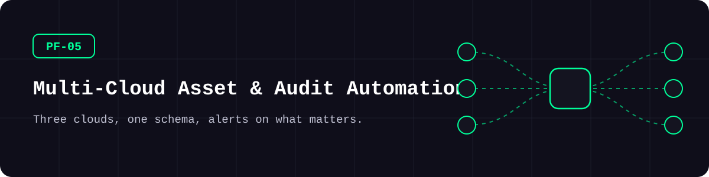
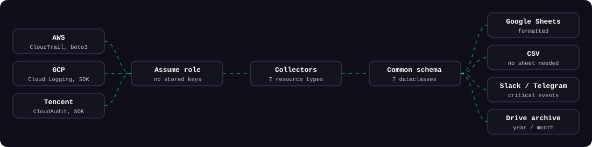
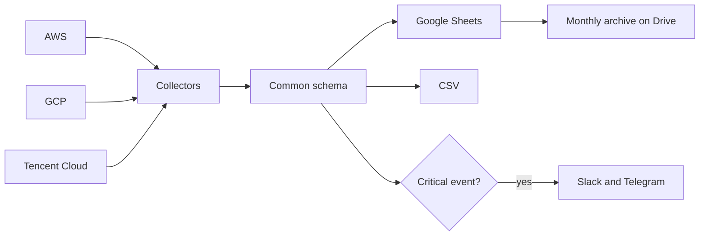

<picture>
  <source media="(prefers-color-scheme: dark)" srcset="docs/assets/banner-dark.svg">
  <source media="(prefers-color-scheme: light)" srcset="docs/assets/banner-light.svg">
  
</picture>

**Pull assets, permissions, and audit logs from three clouds into one table, and get alerted when something risky happens.**

[](https://github.com/kimjhtlzk/pf-05-multicloud-asset-audit-automation/actions/workflows/ci.yml)    [](https://github.com/kimjhtlzk/pf-05-multicloud-asset-audit-automation/actions/workflows/ci.yml) [](LICENSE)

English | [한국어](README.ko.md) · [Portfolio](https://github.com/kimjhtlzk)

## At a glance

- **3 clouds, 7 resource types, 1 schema**
- **49 audit actions tracked, 16 of them alert immediately**
- **9,800 lines of scripts became about 2,150 lines** by removing per-folder duplication
- **Runs with `--demo`** on fake data, with no credentials and no network

## Architecture

<picture>
  <source media="(prefers-color-scheme: dark)" srcset="docs/assets/pipeline-dark.svg">
  <source media="(prefers-color-scheme: light)" srcset="docs/assets/pipeline-light.svg">
  
</picture>



## Demo


## What's inside

| Feature | Description | Main APIs |
|---|---|---|
| `iam` | Users, groups, permissions, keys, last login | IAM, CAM, Resource Manager |
| `firewall` | One row per rule and peer | Security groups, GCP firewalls |
| `instance` | Size, disks, IPs, state, protection | EC2, Compute, CVM |
| `loadbalancer` | Listeners, targets, health checks | ELBv2, Compute, CLB |
| `vpc` | One row per subnet | EC2, Compute, VPC |
| `audit_log` | Last month's changes, normalized | CloudTrail, Cloud Logging, CloudAudit |
| `unused` | Idle IPs, disks, security groups, and firewalls | EC2, Compute, VPC, CBS |
| Sheets and CSV | Header style, filter, width, frozen header | Google Sheets |
| Alerts | Slack and Telegram for critical events | Webhook, Bot API |
| Monthly archive | CSV backup in year and month folders | Google Drive |
| Operations | Disk images, snapshots, rolling GKE exclusion | Compute, CBS, GKE |

### Critical event rules

| Cloud | Critical events |
|---|---|
| AWS | `AttachUserPolicy`, `CreateAccessKey`, `StopInstances`, `TerminateInstances`, `ModifyInstanceAttribute` |
| GCP | `SetIamPolicy`, `CreateServiceAccountKey`, instance stop, delete, and machine type change |
| Tencent Cloud | `AttachUserPolicy`, `AttachUserPolicies`, `CreateApiKey`, `StopInstances`, `TerminateInstances`, `ResetInstancesType` |

Edit [`critical_events.yaml`](src/cloud_asset_audit/rules/critical_events.yaml) to change them.

## Repository structure

```text
.
├── src/cloud_asset_audit/
│   ├── cli.py                 # cloud-audit command
│   ├── config.py              # YAML settings
│   ├── models.py              # one schema per resource
│   ├── providers/             # sessions and cross-account access
│   ├── collectors/            # seven resource types
│   ├── rules/                 # critical event list
│   ├── sinks/                 # Google Sheets and CSV
│   ├── notify/                # Slack and Telegram
│   ├── jobs/                  # monthly archive
│   └── tools/                 # snapshots, GKE exclusion
├── tests/                     # moto and mocks, no network
├── examples/                  # config template, fake output
└── docs/permissions/          # least-privilege policies
```

## Quick start

| Tool | Version |
|---|---|
| Python | 3.11 or newer |

```bash
pip install -e .
cloud-audit collect --demo
```

<details>
<summary>Advanced: run against real accounts</summary>

```bash
pip install -e ".[all]"
cp examples/config.example.yaml config.yaml
export TENCENTCLOUD_SECRET_ID=...    # and its partner variable
gcloud auth application-default login
cloud-audit collect --config config.yaml --output csv
```

Grant only the permissions in [`docs/permissions/`](docs/permissions).

</details>

## Usage examples

**Compare IAM across clouds:**

```bash
cloud-audit collect --resource iam --cloud aws,gcp,tencent --config config.yaml --output csv
```

**Refresh one project:**

```bash
cloud-audit collect --resource instance --project svc-a-dev --config config.yaml --output sheets
```

**Collect audit logs and send alerts:**

```bash
cloud-audit collect --resource audit_log --config config.yaml --output sheets --notify
```

## Design decisions

- **One schema across clouds**, so reviewers read one table.
- **One file per resource type**, so three clouds can be compared side by side.
- **Standard credential chains only**, so no key file lives near the code.
- **Critical events are data**, so security staff can change them without Python.

Full records: [docs/DECISIONS.md](docs/DECISIONS.md)

## Security considerations

- Read-only permissions by default. See [`docs/permissions/`](docs/permissions)
- No credential files. AWS roles, GCP impersonation, and environment variables only
- Alerts only use HTTPS endpoints
- CI runs gitleaks on every push

## Real-world context

This tool checked a multi-account estate across several cloud providers. It ran daily before dawn and removed several days of manual month-end checks. Together with module defaults and CI gates, it helped raise the remediation rate for cloud security findings from 60% to over 85%.

## What changed in this refactor

| Type | Change |
|---|---|
| Structure | Per-folder scripts became one package and one CLI |
| Sensitive data | Key files, paths, sheet IDs, and role names removed or moved to settings |
| Tests and CI | pytest with moto and mocks, ruff, mypy, gitleaks |
| **New for the demo** | `--demo`, CSV output, sample output |
| **Rewritten** | Slack and Telegram alerts, which were not part of the earlier scripts |

Details: [docs/REFACTOR_NOTES.md](docs/REFACTOR_NOTES.md)

## Limitations and roadmap

- GCP load balancer output covers forwarding rules, backends, and health checks, but no longer lists certificates per proxy.
- GCP and Tencent Cloud paths are tested with mocks, not live accounts.
- Tencent Cloud multi-account access needs one CAM role per account.

## Author

**Kim JunHyun** · Public Cloud Infrastructure & Security Engineer

[Portfolio](https://github.com/kimjhtlzk) · [LinkedIn](https://www.linkedin.com/in/ihanni/) · [Blog](https://hann-blume.tistory.com/)

## More in this series

| No. | Repository | What it shows |
|---|---|---|
| PF-01 | [pf-01-aws-terraform-multi-region](https://github.com/kimjhtlzk/pf-01-aws-terraform-multi-region) | 16-region AWS platform from one `locals` map |
| PF-02 | [pf-02-gcp-terraform-gke-platform](https://github.com/kimjhtlzk/pf-02-gcp-terraform-gke-platform) | GKE platform with surge upgrades and a deny-first firewall |
| PF-03 | [pf-03-tencent-terraform-audit-ready](https://github.com/kimjhtlzk/pf-03-tencent-terraform-audit-ready) | Tencent Cloud IaC with audit trails stored in COS |
| PF-04 | [pf-04-aws-terragrunt-dry-iac](https://github.com/kimjhtlzk/pf-04-aws-terragrunt-dry-iac) | DRY Terragrunt layout with a real dependency graph |
| PF-05 | [pf-05-multicloud-asset-audit-automation](https://github.com/kimjhtlzk/pf-05-multicloud-asset-audit-automation) | Asset and audit collection across three clouds |
| PF-06 | [pf-06-aethercrew-ai-company](https://github.com/kimjhtlzk/pf-06-aethercrew-ai-company) | Role-based multi-agent company with safety controls |
| PF-09 | [pf-09-aws-netops-firewall-automation](https://github.com/kimjhtlzk/pf-09-aws-netops-firewall-automation) | Check, apply, and verify firewall changes across AWS accounts |
